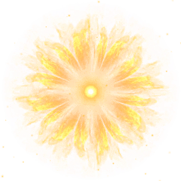

### Learning. Building. Breaking. Repeating.

##  Overview

Exploring the world of software development through hands-on projects, continuous learning, and experimentation. Currently focused on **C++**, **DSA** and **Web Development**.

**Featured projects**

- 🌊 [**FloodSetu**](https://github.com/Rashmi-builds/FloodSetu): Decentralized multi-agent flood rescue dispatch engine with Contract-Net auctions, offline citizen SOS, and tamper-evident relief ledger.
- 🛒 [**VyaparAI**](https://github.com/Rashmi-builds/vyaparai): Intelligent retail billing and inventory management workspace with voice-assisted POS and offline analytics.
- 🌐 [**Babel Boosters**](https://github.com/Rashmi-builds/BabelBoosters): A community glossary of open-source words, translated into the languages people actually speak.

<b>Philosophy &amp; Direction</b> (click to inspect)

> *"Understand the problem before chasing the solution. Build with purpose, learn through experimentation, and let consistency shape the process."*
>
> I believe good engineering begins with asking the right questions. I prefer understanding the fundamentals, exploring different approaches, and keeping things simple before making them complex. I value thoughtful problem-solving over shortcuts, practical learning over assumptions, and steady progress over quick results. My direction is to build things that are not only functional, but also useful, well-considered, and thoughtfully put together.

##  Engineering Domains

*Areas I'm exploring through learning, experimentation, and building.*

- Software Development & Web Engineering
- Frontend Development & Interactive Interfaces
- Backend Systems & API Development
- Data Structures & Algorithmic Problem Solving
- Computational Thinking & Programming Fundamentals
- Graphic Design & Visual Communication
- Creative Technology & Digital Experiences

🛠️ Technical Arsenal

 

#<h3 align="center">AGENTIC & COMPUTATIONAL SYSTEMS</h3>

<table align="center">
  <tr>
    <td align="center" width="220">
        
      <b>01 - Antigravity</b> 
      Google — Agentic IDE  
      
    </td>
    <td align="center" width="220">
        
      <b>02 - Claude Code</b> 
      Anthropic — Terminal Agent  
      
    </td>
    <td align="center" width="220">
        
      <b>03 - ChatGPT Codex</b> 
      OpenAI — Cloud AI Agent  
      
    </td>
    <td align="center" width="220">
        
      <b>04 - OpenCode</b> 
      Open Source — Autonomous Agent  
      
    </td>
  </tr>
</table>
## Analytics & Milestones

<!--
-->

 

Activity tracking across a year of contributions.

## Connect

**Have an idea worth exploring, a problem worth solving, or something new worth building?**

 

  

> ### ✨ *"Curiosity gives direction to ideas; engineering gives them form."*
>
> **Learning through exploration. Building through experimentation. Growing through every line of code, every design, and every problem solved.**

)
## 🚀 Popular Repositories

| | |
|---|---|
| 🌊 **[FloodSetu](https://github.com/Rashmi-builds/FloodSetu)** Decentralized multi-agent flood rescue dispatch engine with Contract-Net auctions, offline citizen SOS, and tamper-evident relief ledger. `TypeScript` | 🛒 **[VyaparAI](https://github.com/Rashmi-builds/vyaparai)** Intelligent retail billing and inventory management workspace with voice-assisted POS and offline analytics. `HTML` |
| 🌐 **[Babel Boosters](https://github.com/Rashmi-builds/BabelBoosters)** A community glossary of open-source words, translated into the languages people actually speak. | |
